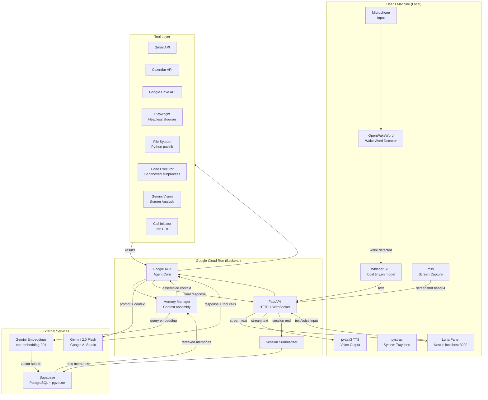

# LUNA — Master Project Plan
### Personal Autonomous AI Assistant
### All Things Agentic Hackathon | Google x Devpost | Deadline: September 1, 2026

---

## Table of Contents

0. [Manual Prerequisites — Do These First](#0-manual-prerequisites--do-these-first)
00. [No-Workaround Policy](#00-no-workaround-policy)
000. [Kill Switch & Boot Switch](#000-kill-switch--boot-switch)
0000. [Credit Safety — Zero Tolerance](#0000-credit-safety--zero-tolerance)
1. [Project Identity](#1-project-identity)
2. [Hackathon Compliance Map](#2-hackathon-compliance-map)
3. [Full Tech Stack](#3-full-tech-stack)
4. [System Architecture](#4-system-architecture)
5. [Repository & Folder Structure](#5-repository--folder-structure)
6. [Database Schema](#6-database-schema-supabase)
7. [Memory System Design](#7-memory-system-design)
8. [Wake Word Pipeline](#8-wake-word-pipeline)
9. [Voice Pipeline](#9-voice-pipeline)
10. [Tool Registry](#10-tool-registry)
11. [UI State Machine](#11-ui-state-machine)
12. [Cost & Infrastructure Strategy](#12-cost--infrastructure-strategy)
13. [Environment Variables & Secrets](#13-environment-variables--secrets)
14. [25-Day Sprint — Day-by-Day](#14-25-day-sprint--day-by-day)
15. [Feature Implementation Details](#15-feature-implementation-details)
16. [Demo Video Script](#16-demo-video-script)
17. [Architecture Diagram Spec](#17-architecture-diagram-spec)
18. [README Structure](#18-readme-structure)
19. [Submission Checklist](#19-submission-checklist)
20. [Post-Hackathon Roadmap](#20-post-hackathon-roadmap)

---

---

## 0. Manual Prerequisites — Do These First

> These are things only you can do. No code is written, no files are created, and no build starts until every item below is checked off. If any of these is missing when we reach a step that needs it, work stops and you are told explicitly.

### You Must Do These Yourself — Before Day 1

**A. Google Account & Cloud Console**

- [ ] Go to [console.cloud.google.com](https://console.cloud.google.com) and sign in with your Google account
- [ ] Create a new GCP project named `luna-hackathon` (keep it separate from any existing projects)
- [ ] Note down the Project ID — it will look like `luna-hackathon-XXXXXX`
- [ ] Go to Billing and link a billing account (required for Cloud Run even with free tier — but we cap it at $0 risk, see Section 0000)
- [ ] Enable these APIs manually in the console (search each one and click Enable):
  - Cloud Run API
  - Cloud Build API
  - Artifact Registry API
  - Gmail API
  - Google Calendar API
  - Google Drive API
  - Secret Manager API

**B. Gemini API Key**

- [ ] Go to [aistudio.google.com](https://aistudio.google.com)
- [ ] Sign in with the same Google account
- [ ] Click "Get API Key" > "Create API key in new project" — select `luna-hackathon`
- [ ] Copy the key and store it somewhere safe (you will paste it into `.env` when I ask)
- [ ] Do NOT paste it anywhere in the codebase or share it

**C. Hackathon Credits**

- [ ] On Devpost, go to the hackathon Resources tab
- [ ] Claim the $150 Google Cloud Credits
- [ ] Apply the credit to the `luna-hackathon` billing account
- [ ] Confirm the credit appears in GCP Billing > Credits

**D. Supabase Setup**

- [ ] Go to [supabase.com](https://supabase.com) and create a free account
- [ ] Create a new project named `luna`
- [ ] Choose a region close to you (e.g. Asia South for India)
- [ ] Set a strong database password — save it somewhere
- [ ] Wait for the project to finish provisioning (~2 minutes)
- [ ] Go to Project Settings > API
  - Copy the `Project URL` (looks like `https://xxxx.supabase.co`)
  - Copy the `service_role` key (the long one under "Secret") — this is your admin key
  - Do NOT use the `anon` key for the backend
- [ ] Go to the SQL Editor in Supabase
- [ ] Run this first: `CREATE EXTENSION IF NOT EXISTS vector;`
- [ ] Confirm it succeeds before proceeding
- [ ] I will give you each SQL migration to run one at a time. You run it. I confirm it worked before moving to the next.

**E. Google OAuth Credentials (for Gmail, Calendar, Drive)**

- [ ] In Google Cloud Console, go to APIs & Services > OAuth consent screen
- [ ] Set User Type to "External"
- [ ] Fill in App name: `Luna`, Support email: your email
- [ ] Add scopes: `gmail.modify`, `calendar.events`, `drive.file`
- [ ] Add your own email as a test user
- [ ] Save and go to Credentials > Create Credentials > OAuth 2.0 Client ID
- [ ] Application type: Desktop app (for local daemon auth)
- [ ] Name it `Luna Desktop Client`
- [ ] Download the JSON file — rename it `google_credentials.json`
- [ ] Place it in `/daemon/` folder when created — never commit this file to git

**F. GCP Billing Caps (Critical — Do This Before Any Deployment)**

- [ ] In GCP Console go to Billing > Budgets & alerts
- [ ] Create a budget:
  - Scope: `luna-hackathon` project
  - Budget amount: $150 (your full credit)
  - Alert thresholds: 25% ($37.50), 50% ($75), 90% ($135)
  - Alert actions: send email to your email address
- [ ] Now create a second budget as the kill switch:
  - Budget amount: $140
  - At 100% threshold: enable "Link to a Pub/Sub topic" — we will wire this to auto-disable billing
  - This means at $140 spent, Cloud Run is automatically killed
  - I will build the Pub/Sub kill switch handler on Day 22 — but YOU must set up the budget here first

**G. gcloud CLI**

- [ ] Install Google Cloud CLI: [cloud.google.com/sdk/docs/install](https://cloud.google.com/sdk/docs/install)
- [ ] Run: `gcloud auth login` — sign in with your Google account
- [ ] Run: `gcloud config set project luna-hackathon-XXXXXX` (your actual project ID)
- [ ] Run: `gcloud auth configure-docker` — needed for Cloud Build
- [ ] Confirm: `gcloud run services list` runs without error

**H. Node.js and Python**

- [ ] Confirm Python 3.12 is installed: `python --version`
- [ ] Confirm Node.js 20+ is installed: `node --version`
- [ ] Confirm npm is installed: `npm --version`
- [ ] If any are missing, install them before Day 1 starts

---

## 00. No-Workaround Policy

This is a hard rule that applies to every build session from Day 1 to Day 25.

**If something is missing, work stops. Always.**

| Situation | What Happens |
|---|---|
| Supabase table does not exist | Work stops. You are told to go to Supabase SQL Editor and run the exact SQL provided. Work resumes only after you confirm it is done. |
| API key is missing or invalid | Work stops. You are told which key is missing, where to get it, and exactly where to put it. |
| OAuth credentials file missing | Work stops. You are told to place `google_credentials.json` in the correct folder. |
| GCP project not selected | Work stops. You are told to run `gcloud config set project [id]`. |
| A Google API not enabled | Work stops. You are told to go to GCP Console > APIs & Services and enable the specific API by name. |
| Cloud Run deployment fails | Work stops. The exact error is shown, you are told what to do, and we re-attempt after you confirm. |
| Environment variable not set | Work stops. You are told which variable, what value format it expects, and where to put it. |
| Supabase RLS blocks a query | Work stops. You are shown the exact policy SQL to run and asked to confirm it was applied. |

No silent fallbacks. No mock data substitutions without explicit permission. No "I'll just hardcode this for now" shortcuts that get forgotten.

---

## 000. Kill Switch & Boot Switch

Two switches. One kills everything. One starts everything. Both are single commands.

### Software Kill Switch

A script at the root of the repo: `kill_luna.py`

```python
# kill_luna.py
# Run this to immediately stop all Luna processes on this machine
# Usage: python kill_luna.py

import subprocess
import sys
import os

print("Stopping Luna...")

# Kill the daemon (wake word listener, STT, TTS, tray)
subprocess.run(["taskkill", "/F", "/IM", "luna_daemon.exe"], capture_output=True)  # if compiled
subprocess.run([sys.executable, "-m", "psutil"], capture_output=True)  # fallback via psutil

# Find and kill all Python processes running luna daemon
import psutil
for proc in psutil.process_iter(['pid', 'name', 'cmdline']):
    try:
        if proc.info['cmdline'] and any('luna' in arg.lower() or 'daemon' in arg.lower()
                                         for arg in proc.info['cmdline']):
            proc.kill()
            print(f"Killed process: {proc.info['pid']} — {' '.join(proc.info['cmdline'][:2])}")
    except (psutil.NoSuchProcess, psutil.AccessDenied):
        pass

# Kill the Next.js panel (any Node process on port 3000)
subprocess.run(["npx", "kill-port", "3000"], capture_output=True, shell=True)

# Kill the local FastAPI backend if running locally
subprocess.run(["npx", "kill-port", "8000"], capture_output=True, shell=True)

print("Luna is fully stopped.")
print("Cloud Run on GCP still exists but scales to zero with no requests.")
print("To disable Cloud Run entirely: gcloud run services update luna-backend --no-traffic")
```

### GCP Cloud Kill Switch (Remote)

Run this to immediately stop the Cloud Run service and prevent any further cloud invocations:

```bash
# Immediately remove all traffic from Cloud Run (zero invocations possible)
gcloud run services update-traffic luna-backend --to-revisions=LATEST=0 --region=us-central1

# Or delete the service entirely if you want a clean stop
gcloud run services delete luna-backend --region=us-central1
```

A one-liner kill script is also saved as `kill_cloud.sh` in the repo root:

```bash
#!/bin/bash
# kill_cloud.sh — immediately stop all Luna cloud resources
echo "Killing Luna on GCP..."
gcloud run services update-traffic luna-backend --to-revisions=LATEST=0 --region=us-central1
gcloud scheduler jobs pause luna-healthcheck --location=us-central1 2>/dev/null || true
echo "Cloud Run is now receiving 0 traffic."
echo "Your credits are safe. Run boot_cloud.sh to restore."
```

### Automatic Kill Switch (Budget-Triggered)

This runs automatically when GCP spend reaches $140. Requires Pub/Sub setup on Day 22.

The Pub/Sub subscription triggers a Cloud Function that runs:
```python
# Triggered automatically by GCP Budget Alert at $140
def kill_on_budget(event, context):
    from googleapiclient.discovery import build
    service = build('run', 'v1')
    # Set Cloud Run to receive 0% of traffic
    service.namespaces().services().replaceService(
        name='namespaces/luna-hackathon/services/luna-backend',
        body={"spec": {"traffic": [{"percent": 0, "latestRevision": True}]}}
    ).execute()
    print("Budget kill switch triggered. Luna Cloud Run set to 0 traffic.")
```

You will be notified at $37.50, $75, and $135 by email. At $140 the service dies automatically with no action needed from you.

### Boot Switch

A single script at the repo root: `boot_luna.py`

```python
# boot_luna.py
# Run this to start Luna completely (daemon + panel)
# Usage: python boot_luna.py

import subprocess
import sys
import os
import time
import webbrowser

print("Starting Luna...")

# Start the Next.js panel in background
panel_process = subprocess.Popen(
    ["npm", "run", "dev"],
    cwd=os.path.join(os.path.dirname(__file__), "panel"),
    creationflags=subprocess.CREATE_NEW_CONSOLE  # Windows: opens in separate window
)
print("Panel starting at localhost:3000...")

# Wait for panel to be ready
time.sleep(4)

# Start the daemon
daemon_process = subprocess.Popen(
    [sys.executable, "main.py"],
    cwd=os.path.join(os.path.dirname(__file__), "daemon")
)
print("Daemon started. Listening for wake word.")

# Open the panel in browser (minimized)
webbrowser.open("http://localhost:3000")

print()
print("Luna is running.")
print("Say 'Hey Luna' to activate.")
print("Run kill_luna.py to stop everything.")
```

### Cloud Boot Switch

```bash
#!/bin/bash
# boot_cloud.sh — restore Luna cloud resources after a kill
gcloud run services update-traffic luna-backend --to-revisions=LATEST=100 --region=us-central1
echo "Cloud Run restored. Luna backend is live."
```

### Summary: The Four Switches

| Switch | Command | What It Does |
|---|---|---|
| Local boot | `python boot_luna.py` | Starts panel, daemon, opens browser |
| Local kill | `python kill_luna.py` | Kills all local Luna processes |
| Cloud kill | `bash kill_cloud.sh` | Sets Cloud Run to 0 traffic instantly |
| Cloud boot | `bash boot_cloud.sh` | Restores Cloud Run to 100% traffic |

---

## 0000. Credit Safety — Zero Tolerance

Every possible way GCP credits can be drained, and how we block it.

### Known Credit Drains — All Blocked

| Risk | How It Drains Credits | How We Block It |
|---|---|---|
| Cloud Run min-instances > 0 | Instance runs 24/7, charges compute even with zero requests | `--min-instances=0` always. Non-negotiable. |
| Playwright running in Cloud Run | Headless Chromium in cloud = high memory, high CPU, high cost | Playwright runs ONLY in the local daemon. Cloud Run never touches a browser. |
| Cloud Scheduler health-check pings | Even a simple GET /health every 5 min = 8,640 invocations/month of Cloud Run compute time | No health-check pings. Cloud Run cold starts are fast enough. Demo is fine without it. |
| Gemini API called in a loop | Runaway tool chain or retry loop = hundreds of calls | Hard cap: max 3 tool calls per conversation turn. Max 10 turns per session. Hard stop after that. |
| Gemini embeddings per message | Embedding every message individually = wasteful | Embed only at session end during summarization. Retrieval embeds only the single query, not every message. |
| Large image payloads to Gemini Vision | Sending uncompressed 4K screenshots = high token count + possible cost | Screenshots are resized to max 1280x720 before sending. Capped at ~500KB. |
| Long output tokens | Gemini generating 5,000-word essays | Hard output token cap: 1,000 tokens. Enforced in every API call. |
| Cloud Build running on every push | CI/CD pipelines trigger Cloud Build = build minutes consumed | No CI/CD pipeline. Deployments are manual, triggered only by you explicitly. |
| Artifact Registry storing many images | Each Docker image version stored = storage cost | We keep only the latest 2 image versions. Older ones deleted manually after each deploy. |
| Secret Manager high access | Reading secrets on every Cloud Run cold start = API calls | Secrets loaded once at startup, cached in memory for the session. |
| Cloud Logging excessive writes | Every debug log written to Cloud Logging = logging cost | Log level set to WARNING in production. Debug logs only in local dev. |
| Idle WebSocket connections | Open WebSocket held even when not in use | WebSocket auto-closes after 90 seconds of inactivity. Client reconnects on next message. |
| Session never ending | If user never says goodbye, session runs forever and keeps Cloud Run warm | Automatic session timeout at 60 seconds of silence. Hard max session length: 15 minutes. |

### Credit Budget Projection

With all the above controls in place:

| Scenario | Est. Cloud Run Calls/Day | Est. Compute Time | Est. Daily Cost |
|---|---|---|---|
| Light use (5-10 convos) | ~100 requests | ~100 seconds total | ~$0.00 |
| Medium use (20-30 convos) | ~400 requests | ~400 seconds total | ~$0.00 |
| Heavy hackathon testing | ~1,000 requests | ~1,000 seconds total | ~$0.00 |
| 30-day total (heavy) | ~30,000 requests | ~30,000 seconds | ~$0.30 |

The 2M free requests/month and 360,000 GB-seconds/month free tier covers us entirely. The $150 credit is the buffer for Cloud Build and Artifact Registry usage only.

### The One Rule Above All Others

If you ever see a charge appear in GCP Billing that was not expected, run `kill_cloud.sh` immediately, then tell me and we investigate before re-enabling anything.

---

## 1. Project Identity

**Name:** Luna  
**Tagline:** Every assistant waits for you. Luna doesn't.  
**Category:** Collaborative Partner (primary) + Taskmaster elements (secondary)  
**Track justification:** Luna learns the user's preferences, communication style, working patterns, and unique language over time — adapting its behavior per session. This maps directly to the Collaborative Partner definition: "ask clarifying questions, guide the user step-by-step, and have a clear way to capture feedback, so it constantly adapts to the user's unique way of thinking."  
**Bonus prize targets:** Best Multimodal UX ($5,000) — voice + text + visual panel combined  
**Submission type:** Individual / Solo  
**Deadline:** September 1, 2026 at 5:30 AM IST  

### Design Philosophy
Minimal. Precise. Human-crafted.  
Reference aesthetic: Linear, Arc Browser, Vercel dashboard, Apple HIG.  
No decorative gradients. No glow for atmosphere. No emojis in any interface.  
Every element earns its place. Typography does the heavy lifting.  
Color palette: near-black backgrounds, off-white text, one muted accent used sparingly.

---

## 2. Hackathon Compliance Map

| Requirement | How Luna Satisfies It |
|---|---|
| Gemini 3.5 Flash or newer | Gemini 2.0 Flash via Google AI Studio API key (free tier), with Vertex AI as documented fallback |
| Google Agent Framework | Google Agent Development Kit (ADK) in Python — all tools registered as ADK tools |
| Google Cloud infrastructure | Google Cloud Run — hosts the entire Python backend, scale-to-zero |
| Operates beyond chat loops | Autonomous tool execution: email, web browsing, file creation, screen reading, call initiation — all triggered from a single voice or text command with no user hand-holding |
| Asynchronous operation | Cloud Run invocations are stateless; long tasks (email summarization, web scraping) run async with websocket status updates back to the client |
| Public GitHub repo | MIT licensed, complete README with spin-up instructions |
| Architecture diagram | Mermaid diagram in repo + PNG export in submission |
| 4-minute demo video | Scripted, live, unedited — see Section 16 |
| Cloud proof | Cloud Run dashboard and logs visible in demo video |

---

## 3. Full Tech Stack

### Backend
| Layer | Technology | Version | Why |
|---|---|---|---|
| Language | Python | 3.12 | ADK is Python-native, best library ecosystem for AI tooling |
| Agent Framework | Google ADK | Latest | Mandatory for hackathon; handles tool registration, orchestration, session management |
| LLM | Gemini 2.0 Flash | Latest | Fast, cheap, multimodal (text + image), 1M token context window |
| API Gateway | FastAPI | 0.115+ | Async, fast, auto-generates OpenAPI docs, WebSocket support built-in |
| WebSocket | FastAPI WebSockets | — | Real-time bidirectional communication between backend and frontend panel |
| Containerization | Docker | Latest | Required for Cloud Run deployment |
| Cloud Compute | Google Cloud Run | — | Scale to zero when idle, 2M free requests/month |

### Database & Memory
| Layer | Technology | Why |
|---|---|---|
| Primary DB | Supabase (PostgreSQL) | Free tier, managed, pgvector extension for semantic search |
| Vector Extension | pgvector | Semantic similarity search for memory retrieval |
| Vector Embeddings | Gemini text-embedding-004 | Free via AI Studio, 768-dimension embeddings, same API key as LLM |
| Session cache | In-memory (Python dict on Cloud Run instance) | Fast access for current session context, no latency |

### Frontend — Luna Panel
| Layer | Technology | Why |
|---|---|---|
| Framework | Next.js 15 (App Router) | Server components, streaming, WebSocket client support |
| Styling | Tailwind CSS v4 | Per user rules |
| Animations | Framer Motion | Subtle, precise transitions between UI states |
| Icons | Lucide React | Clean, minimal icon set |
| Fonts | Inter (Google Fonts) | Industry standard for precision UI |
| State | Zustand | Lightweight, no boilerplate |
| Markdown renderer | react-markdown + rehype-highlight | For rendering Luna's formatted responses |

### Local Daemon (runs on user's machine)
| Layer | Technology | Why |
|---|---|---|
| Language | Python | Same language as backend, shared utilities |
| Wake word | OpenWakeWord | Fully offline, free, custom wake phrases, runs on CPU |
| Audio capture | sounddevice + numpy | Cross-platform mic input |
| STT (Speech-to-Text) | OpenAI Whisper (local, tiny model) | Offline, accurate, free, 39MB model |
| TTS (Text-to-Speech) | pyttsx3 (offline) or Web Speech API (browser) | Zero cost, works offline |
| System tray | pystray + Pillow | Cross-platform tray icon management |
| Screenshot | Pillow + mss | Fast screen capture, cross-platform |
| Process management | subprocess | For triggering OS-level actions (open dialer, etc.) |

### Tool Integrations
| Tool | API / Library | Auth Method |
|---|---|---|
| Gmail | Google Gmail API v1 | OAuth 2.0 (user grants once, token stored locally) |
| Google Calendar | Google Calendar API v3 | Same OAuth token as Gmail |
| Google Drive | Google Drive API v3 | Same OAuth token |
| Web browsing | Playwright (Chromium, headless) | None — direct browser automation |
| Web search | Google Custom Search API | API key (100 free searches/day) or SerpAPI free tier |
| File system | Python `pathlib` + `shutil` | Local, no auth |
| Code execution | `subprocess` with timeout + sandbox | Local, restricted user |
| Call initiation | `webbrowser` module + tel: URI | Local OS handler |
| Screen capture | `mss` + Gemini Vision | Local capture, cloud inference |

---

## 4. System Architecture

```
+--------------------------------------------------+
|                 USER'S MACHINE                   |
|                                                  |
|  +--------------------------------------------+ |
|  |           LUNA DAEMON (Python)             | |
|  |                                            | |
|  |  OpenWakeWord ──> Whisper STT ──> text    | |
|  |  pystray (tray icon)                       | |
|  |  mss (screenshot)                          | |
|  |  pyttsx3 (TTS output)                      | |
|  +------------------+-------------------------+ |
|                     |                            |
|                     | HTTPS / WebSocket          |
|                     |                            |
|  +------------------+-------------------------+ |
|  |         LUNA PANEL (Next.js)               | |
|  |         localhost:3000                     | |
|  |                                            | |
|  |  State: IDLE | ACTIVE | VISUAL            | |
|  |  Renders: text, images, code, cards       | |
|  |  Receives: WebSocket push from backend    | |
|  +--------------------------------------------+ |
+---------------------------+----------------------+
                            |
                            | HTTPS (Cloud Run URL)
                            |
+---------------------------+----------------------+
|           GOOGLE CLOUD RUN (Backend)            |
|                                                  |
|  +--------------------------------------------+ |
|  |         FastAPI Application                | |
|  |                                            | |
|  |  POST /chat    — text message entry       | |
|  |  POST /voice   — audio blob entry         | |
|  |  WS   /stream  — real-time response push  | |
|  |  POST /tool    — direct tool invocation   | |
|  |                                            | |
|  |  +--------------------------------------+ | |
|  |  |       LUNA AGENT CORE (ADK)          | | |
|  |  |                                      | | |
|  |  |  1. Memory Retrieval (Supabase)      | | |
|  |  |  2. Context Assembly                 | | |
|  |  |  3. Gemini 2.0 Flash (LLM call)     | | |
|  |  |  4. Tool Selection + Execution       | | |
|  |  |  5. Memory Update (Supabase write)   | | |
|  |  |  6. Response stream to client        | | |
|  |  +--------------------------------------+ | |
|  +--------------------------------------------+ |
|                                                  |
+----------+------------------+-------------------+
           |                  |
    +------+------+    +------+------+
    |  Gemini API |    |  Supabase   |
    |  (Google AI |    |  PostgreSQL |
    |   Studio)   |    |  pgvector   |
    +-------------+    +-------------+
           |
    +------+------+
    | TOOL LAYER  |
    |             |
    | Gmail API   |
    | Calendar    |
    | Playwright  |
    | Filesystem  |
    | Screenshot  |
    +-------------+
```

### Data Flow — Single Request Lifecycle

```
1. User says "Hey Luna"
      |
2. OpenWakeWord detects keyword (local, 0ms latency, 0 tokens)
      |
3. Daemon activates mic recording
      |
4. User speaks command
      |
5. Audio recorded → Whisper processes locally → text string produced
      |
6. Text sent to Cloud Run via HTTPS POST /chat
      |
7. FastAPI receives request
      |
8. Memory Manager queries Supabase pgvector:
   - Generates embedding of the input text (Gemini text-embedding-004)
   - Semantic search: finds top 5 most relevant memories
   - Returns: user preferences, past context, behavioral patterns
      |
9. Context assembled:
   - System prompt (Luna's persona + instructions)
   - Retrieved memories (injected as context, not history)
   - Current conversation turn
   - Token count checked — kept under 8,000 tokens per call
      |
10. Gemini 2.0 Flash called via ADK
    - Returns: response text + optional tool call(s)
      |
11. If tool call detected:
    - Tool executed (Gmail, browser, screenshot, etc.)
    - Result returned to Gemini for final response synthesis
      |
12. Response streamed back to client via WebSocket
      |
13. Daemon receives response text → pyttsx3 speaks it aloud
    Panel receives response → renders text, images, code as appropriate
      |
14. Session ends (user says "goodbye" or 60s silence timeout)
      |
15. Session Summarizer runs:
    - Compresses full conversation into key facts
    - Extracts new preferences/patterns
    - Writes to Supabase memory table as vector embeddings
      |
16. Cloud Run instance scales to zero
    Daemon returns to wake word listening mode
```

---

## 5. Repository & Folder Structure

```
luna/
|
|-- README.md                         # Full setup + spin-up instructions
|-- LICENSE                           # MIT License
|-- .gitignore
|-- architecture.md                   # Architecture diagram (Mermaid)
|-- architecture.png                  # Exported PNG for submission
|
|-- /backend                          # Google Cloud Run service
|   |-- Dockerfile
|   |-- requirements.txt
|   |-- .env.example                  # Template — never commit real .env
|   |-- main.py                       # FastAPI app entry point
|   |
|   |-- /agent
|   |   |-- __init__.py
|   |   |-- core.py                   # ADK agent initialization + session management
|   |   |-- memory.py                 # Supabase memory read/write + embedding logic
|   |   |-- context.py                # Context assembly before each LLM call
|   |   |-- summarizer.py             # Post-session summarization
|   |   |-- persona.py                # Luna's system prompt + personality definition
|   |
|   |-- /tools
|   |   |-- __init__.py               # Tool registry — all tools imported here
|   |   |-- gmail_tool.py             # Read, summarize, draft, send emails
|   |   |-- calendar_tool.py          # Read events, create events, check availability
|   |   |-- drive_tool.py             # Create, read, list Google Drive files
|   |   |-- browser_tool.py           # Playwright headless web browsing + search
|   |   |-- filesystem_tool.py        # Create files, folders, read local content
|   |   |-- code_tool.py              # Write + execute code in a sandboxed subprocess
|   |   |-- screen_tool.py            # Receive screenshot, send to Gemini Vision
|   |   |-- call_tool.py              # Generate tel: URI or Twilio outbound call trigger
|   |   |-- image_search_tool.py      # Search and return image URLs for display
|   |
|   |-- /routes
|   |   |-- chat.py                   # POST /chat — text input
|   |   |-- voice.py                  # POST /voice — audio blob (if needed)
|   |   |-- stream.py                 # WebSocket /stream — push responses
|   |   |-- health.py                 # GET /health — Cloud Run health check
|   |
|   |-- /db
|       |-- supabase_client.py        # Supabase client initialization
|       |-- migrations/               # SQL migration files
|           |-- 001_enable_pgvector.sql
|           |-- 002_create_memories.sql
|           |-- 003_create_sessions.sql
|           |-- 004_create_preferences.sql
|
|-- /daemon                           # Runs on user's local machine
|   |-- requirements.txt
|   |-- main.py                       # Entry point — starts all subsystems
|   |-- wake_word.py                  # OpenWakeWord listener loop
|   |-- stt.py                        # Whisper STT integration
|   |-- tts.py                        # pyttsx3 TTS output
|   |-- tray.py                       # pystray system tray management
|   |-- screenshot.py                 # Screen capture via mss
|   |-- audio.py                      # sounddevice mic input handler
|   |-- config.py                     # Daemon config: backend URL, settings
|
|-- /panel                            # Next.js frontend (localhost:3000)
|   |-- package.json
|   |-- next.config.ts
|   |-- tsconfig.json
|   |-- tailwind.config.ts
|   |
|   |-- /app
|   |   |-- layout.tsx                # Root layout, font loading, global styles
|   |   |-- page.tsx                  # Main panel entry (redirects to /chat)
|   |   |-- /chat
|   |       |-- page.tsx              # Luna chat interface — all three states
|   |
|   |-- /components
|   |   |-- ChatBubble.tsx            # The compact floating overlay (State 2)
|   |   |-- SidePanel.tsx             # The expanded visual panel (State 3)
|   |   |-- MessageList.tsx           # Scrollable conversation history
|   |   |-- Message.tsx               # Single message — text, image, code, card
|   |   |-- MicButton.tsx             # Mic input trigger
|   |   |-- ImageCard.tsx             # Image result display
|   |   |-- CodeBlock.tsx             # Syntax-highlighted code
|   |   |-- StatusIndicator.tsx       # Active / thinking / idle state dot
|   |
|   |-- /lib
|   |   |-- websocket.ts              # WebSocket client connection manager
|   |   |-- store.ts                  # Zustand global state
|   |   |-- types.ts                  # TypeScript interfaces
|   |
|   |-- /styles
|       |-- globals.css               # Base styles, CSS variables, font imports
|
|-- /docs
    |-- HACKATHON_NOTES.md            # Notes for submission write-up
    |-- SPIN_UP.md                    # Extended local setup guide
    |-- demo_script.md                # Demo video script
```

---

## 6. Database Schema (Supabase)

### Table: memories
Stores everything Luna learns about the user. This is the core of Luna's personalization.

```sql
CREATE TABLE memories (
    id           UUID PRIMARY KEY DEFAULT gen_random_uuid(),
    user_id      TEXT NOT NULL DEFAULT 'default',  -- single user for hackathon
    content      TEXT NOT NULL,                    -- the raw memory text
    source       TEXT NOT NULL,                    -- 'conversation' | 'preference' | 'correction'
    embedding    vector(768),                      -- Gemini text-embedding-004 output
    importance   FLOAT DEFAULT 1.0,               -- decay weight, higher = more important
    tags         TEXT[],                           -- ['email', 'coding', 'schedule', etc.]
    created_at   TIMESTAMPTZ DEFAULT now(),
    last_accessed TIMESTAMPTZ DEFAULT now()
);

CREATE INDEX memories_embedding_idx ON memories
    USING ivfflat (embedding vector_cosine_ops)
    WITH (lists = 100);
```

### Table: sessions
Tracks each conversation session for analytics and debug.

```sql
CREATE TABLE sessions (
    id            UUID PRIMARY KEY DEFAULT gen_random_uuid(),
    started_at    TIMESTAMPTZ DEFAULT now(),
    ended_at      TIMESTAMPTZ,
    summary       TEXT,                            -- post-session compressed summary
    turns         INTEGER DEFAULT 0,              -- number of exchanges
    tools_used    TEXT[],                          -- which tools were called
    token_count   INTEGER DEFAULT 0               -- total tokens used this session
);
```

### Table: preferences
Explicit user preferences extracted from corrections and instructions.

```sql
CREATE TABLE preferences (
    id          UUID PRIMARY KEY DEFAULT gen_random_uuid(),
    key         TEXT NOT NULL UNIQUE,              -- 'email_tone', 'code_language', 'wake_word', etc.
    value       TEXT NOT NULL,
    updated_at  TIMESTAMPTZ DEFAULT now()
);
```

### Table: pending_tasks
For future async task support — tasks Luna is monitoring or waiting on.

```sql
CREATE TABLE pending_tasks (
    id           UUID PRIMARY KEY DEFAULT gen_random_uuid(),
    description  TEXT NOT NULL,
    tool         TEXT NOT NULL,
    params       JSONB,
    status       TEXT DEFAULT 'pending',           -- 'pending' | 'running' | 'done' | 'failed'
    created_at   TIMESTAMPTZ DEFAULT now(),
    completed_at TIMESTAMPTZ
);
```

### Row Level Security
```sql
-- Enable RLS on all tables
ALTER TABLE memories ENABLE ROW LEVEL SECURITY;
ALTER TABLE sessions ENABLE ROW LEVEL SECURITY;
ALTER TABLE preferences ENABLE ROW LEVEL SECURITY;
ALTER TABLE pending_tasks ENABLE ROW LEVEL SECURITY;

-- Service role has full access (used by backend)
CREATE POLICY "service_full_access" ON memories
    FOR ALL USING (true);
-- (Same policy pattern for all tables when using service role key)
```

---

## 7. Memory System Design

Luna's memory is the feature that separates it from every other chatbot. It must be designed carefully.

### Two-Layer Architecture

**Layer 1 — Working Memory (in-session)**
- Lives in Python dict on the Cloud Run instance
- Stores current conversation turns (user + Luna messages)
- Automatically cleared when session ends
- Max: last 10 turns in raw form (prevents context overflow)

**Layer 2 — Long-Term Memory (persistent, Supabase)**
- Vector embeddings of distilled facts about the user
- Retrieved via cosine similarity search before every LLM call
- Written at end of every session via the Summarizer

### What Gets Stored as Memory

```
Category: Preferences
  Examples:
    - "User prefers emails to be written in a formal but warm tone"
    - "User writes code in Python. Prefers type hints. Dislikes verbose comments."
    - "User's Gmail account is [email]. Primary calendar is Personal."
    - "User refers to his father as 'Appa' and his best friend as 'Karthik'"

Category: Corrections
  Examples:
    - "When user says 'send this to Priya' he means priya.k@gmail.com"
    - "User corrected Luna: do not add greetings to file names"
    - "User does not like when Luna asks too many clarifying questions — act first"

Category: Behavioral Patterns
  Examples:
    - "User typically works late, most active between 10pm and 2am"
    - "User often asks Luna to summarize emails first thing after wake word"
    - "User has asked Luna to browse for research 14 times — high frequency tool"

Category: Facts
  Examples:
    - "User's name is [name]. Goes by Sir in Luna's responses."
    - "User is building Luna for the All Things Agentic Hackathon, deadline Sept 1 2026"
    - "User's primary project folder is at C:/Users/shree/shree_projects/"
```

### Memory Retrieval Logic

```python
async def retrieve_relevant_memories(query: str, top_k: int = 5) -> list[str]:
    # 1. Embed the current user query
    query_embedding = await embed(query)

    # 2. Query Supabase pgvector for top_k most similar memories
    results = supabase.rpc('match_memories', {
        'query_embedding': query_embedding,
        'match_threshold': 0.75,
        'match_count': top_k
    }).execute()

    # 3. Update last_accessed timestamp (for decay logic later)
    # 4. Return as list of content strings
    return [r['content'] for r in results.data]
```

### Context Assembly Before Each LLM Call

```
SYSTEM PROMPT (persona, ~500 tokens, cached)
+
RETRIEVED MEMORIES (top 5 relevant, ~400 tokens)
+
WORKING MEMORY (last 6 turns, ~600 tokens)
+
CURRENT USER MESSAGE (~50-200 tokens)
---
TOTAL: ~1,550-1,700 tokens per call (well within free tier limits)
```

### Session Summarizer

Runs automatically when a session ends. Sends the full conversation to Gemini with a prompt like:

```
"From the following conversation, extract:
1. Any new facts about the user (name references, locations, relationships)
2. Any preferences the user expressed (style, tone, format, tools)
3. Any corrections the user made to Luna's behavior
4. Any important tasks or decisions made

Output as a JSON array of memory objects: [{content, source, tags, importance}]"
```

The output is embedded and stored in Supabase. This is how Luna gets smarter over time without ever re-reading raw conversation logs.

---

## 8. Wake Word Pipeline

### How It Works

```
[Microphone]
     |
     | raw audio stream (16kHz, mono, float32)
     v
[OpenWakeWord model: 'hey luna' custom or 'hey jarvis' prebuilt]
     |
     | detection score > threshold (0.5)
     v
[Daemon activates]
     |
     | plays a short audio chime (acknowledgment)
     | sends signal to Panel: state = ACTIVE
     v
[sounddevice starts recording]
     |
     | user speaks command
     | silence detected for > 1.5 seconds: recording stops
     v
[Whisper tiny model processes audio locally]
     |
     | returns transcribed text string
     v
[Daemon sends POST to Cloud Run backend]
```

### OpenWakeWord Setup

```python
# daemon/wake_word.py
import openwakeword
from openwakeword.model import Model

oww_model = Model(
    wakeword_models=["hey_luna"],   # custom model trained on "hey luna"
    inference_framework="onnx"
)

# If custom model not available day 1, use prebuilt:
# wakeword_models=["alexa"]  — swap to "hey luna" once trained
```

### Custom Wake Word Training
OpenWakeWord allows custom wake words trained on synthetic data. Steps:
1. Use the `openwakeword` CLI to generate synthetic audio samples for "hey luna"
2. Train the model (takes ~30 minutes on CPU, free)
3. Output: a `.onnx` model file stored in `/daemon/models/hey_luna.onnx`
4. This is done in Week 1, Day 2

### Silence Detection
```python
# daemon/audio.py
import sounddevice as sd
import numpy as np

def record_until_silence(samplerate=16000, silence_threshold=0.01, silence_duration=1.5):
    frames = []
    silence_frames = 0
    frames_per_check = int(samplerate * 0.1)  # check every 100ms

    with sd.InputStream(samplerate=samplerate, channels=1, dtype='float32') as stream:
        while True:
            data, _ = stream.read(frames_per_check)
            frames.append(data)
            rms = np.sqrt(np.mean(data**2))
            if rms < silence_threshold:
                silence_frames += 1
            else:
                silence_frames = 0
            if silence_frames * 0.1 >= silence_duration:
                break
    return np.concatenate(frames, axis=0)
```

---

## 9. Voice Pipeline

### Speech-to-Text (STT)
- **Model:** Whisper `tiny.en` — 39MB, runs locally on CPU in ~1-2 seconds
- **Why tiny:** Fast enough for conversational latency, accurate enough for clear speech
- **Upgrade path:** Switch to `base.en` if accuracy issues arise (74MB, ~2-3 seconds)

```python
# daemon/stt.py
import whisper
import numpy as np

model = whisper.load_model("tiny.en")

def transcribe(audio_array: np.ndarray, samplerate: int = 16000) -> str:
    result = model.transcribe(audio_array, fp16=False, language="en")
    return result["text"].strip()
```

### Text-to-Speech (TTS)
- **Primary:** `pyttsx3` — offline, zero cost, system voices
- **Voice selection:** Choose the most natural available system voice on first setup
- **Speed:** Set to 160 wpm (slightly slower than default for clarity)

```python
# daemon/tts.py
import pyttsx3

engine = pyttsx3.init()
engine.setProperty('rate', 160)
engine.setProperty('volume', 0.9)

voices = engine.getProperty('voices')
# Select best available voice — preference: female, English
engine.setProperty('voice', voices[1].id)  # index varies by system

def speak(text: str):
    # Strip markdown formatting before speaking
    clean = text.replace("**", "").replace("*", "").replace("`", "")
    engine.say(clean)
    engine.runAndWait()
```

### Voice Input from Panel (Web)
The Next.js panel also supports voice input using the browser's `Web Speech API`:
```typescript
// panel/components/MicButton.tsx
const recognition = new window.SpeechRecognition();
recognition.continuous = false;
recognition.lang = 'en-US';
recognition.onresult = (event) => {
    const transcript = event.results[0][0].transcript;
    sendToBackend(transcript);
};
```

This allows voice input from the browser tab without needing the daemon running — good for demo scenarios.

---

## 10. Tool Registry

All tools are registered with Google ADK. Each tool is a Python function with a docstring that ADK uses to decide when to call it.

### Tool Specification Pattern

```python
# backend/tools/gmail_tool.py
from google.adk.tools import tool

@tool
def read_latest_emails(count: int = 5) -> str:
    """
    Reads the user's most recent Gmail emails.
    Use when the user asks to check, read, or summarize their email.
    Returns a formatted string with sender, subject, and preview.

    Args:
        count: Number of emails to retrieve. Default is 5.
    """
    # ... implementation
```

### Complete Tool List

| Tool Name | Trigger Examples | Returns |
|---|---|---|
| `read_latest_emails` | "check my emails", "any new messages?" | Formatted email summaries |
| `send_email` | "send an email to X saying Y" | Confirmation |
| `draft_email` | "draft a reply to this email" | Draft text for user approval |
| `search_emails` | "find emails from Priya about the project" | Matching email list |
| `read_calendar` | "what's on my calendar today?" | Event list |
| `create_event` | "schedule a meeting with X tomorrow at 3pm" | Confirmation + event link |
| `check_availability` | "am I free on Friday afternoon?" | Availability status |
| `browse_web` | "search for X", "go to this website" | Extracted text content |
| `search_images` | "show me what X looks like" | Image URL for panel display |
| `get_news` | "latest news on X" | Headline + summary list |
| `create_file` | "create a file called X with content Y" | File path confirmation |
| `create_folder` | "make a folder called X in my projects" | Folder path confirmation |
| `read_file` | "read the content of X" | File contents |
| `list_files` | "what's in my downloads folder?" | Directory listing |
| `run_code` | "run this Python script", "execute this" | Output / error |
| `write_code` | "write a function that does X" | Code block (displayed in panel) |
| `capture_screen` | "what's on my screen?", "read this error" | Gemini Vision analysis of screenshot |
| `initiate_call` | "call X", "dial this number" | Opens OS dialer / confirmation |
| `send_whatsapp` | "send X a WhatsApp saying Y" | Opens WhatsApp with pre-filled message |
| `create_doc` | "create a Google Doc titled X" | Doc URL |
| `take_note` | "remember this", "note this down" | Note saved confirmation |
| `recall_note` | "what did I ask you to remember about X?" | Retrieved note content |
| `save_preference` | "from now on, always do X" | Preference stored confirmation |

### Tool Execution Flow in ADK

```
Gemini decides to call tool 'search_images' with args: {query: "mango fruit"}
    |
ADK intercepts the tool call
    |
image_search_tool.search_images(query="mango fruit") executes
    |
Returns: {"image_url": "https://...", "alt_text": "ripe mango fruit"}
    |
ADK feeds result back to Gemini
    |
Gemini generates final response: "Here is a mango, Sir."
    |
Backend sends to panel via WebSocket:
{
  "type": "image",
  "url": "https://...",
  "caption": "Mango",
  "text": "Here is a mango, Sir."
}
    |
Panel renders image card + text
```

---

## 11. UI State Machine

### States

```
IDLE
  - Only the pystray tray icon visible
  - OpenWakeWord listener running in daemon
  - Panel tab exists at localhost:3000 but is minimized
  - No cloud resources active
  - Cost: $0

  TRIGGER: Wake word detected OR user clicks tray icon

ACTIVE
  - Panel tab comes to foreground (JS focus() call)
  - Compact chat bubble visible (bottom-right of screen, 340px wide)
  - Mic is live, listening for command
  - Status dot: pulsing (thinking) or solid (listening)

  TRIGGER: Luna's response contains an image, code block, table, long text (>200 chars),
           or any visual content

VISUAL
  - Chat bubble expands (animated, 300ms ease-out) into full side panel (320px wide)
  - Panel docks to right edge of screen (CSS: position fixed, right: 0)
  - Main window content reflows to 70% width (if panel is inside a browser)
  - Rich content rendered: ImageCard, CodeBlock, markdown
  - User can collapse back to bubble manually

  TRIGGER: User says "goodbye", "sleep", "close", or 60s of silence

IDLE (return)
  - Panel animates out
  - Tray icon dims slightly to indicate idle
  - Session summarizer runs in background
```

### UI Component Hierarchy

```
<LunaPanel>          — root, handles state transitions
  <StatusBar>        — "IDLE" | "LISTENING" | "THINKING" | "SPEAKING"
  <MessageList>      — scrollable chat history
    <Message>        — each turn
      <TextContent>  — markdown-rendered text
      <ImageCard>    — image display when type === "image"
      <CodeBlock>    — syntax-highlighted code
      <InfoCard>     — structured data (weather, calendar event, etc.)
  <InputBar>         — text input + MicButton
    <MicButton>      — Web Speech API trigger
```

### Design Tokens (CSS Variables)

```css
:root {
  /* Colors */
  --color-bg-base:     #0a0a0a;
  --color-bg-panel:    #111111;
  --color-bg-hover:    #1a1a1a;
  --color-border:      #2a2a2a;
  --color-text-primary:  #e8e8e8;
  --color-text-secondary: #666666;
  --color-text-tertiary:  #444444;
  --color-accent:      #7c6fcd;  /* muted lavender — used sparingly */
  --color-accent-dim:  #7c6fcd22;

  /* Typography */
  --font-sans:    'Inter', system-ui, sans-serif;
  --font-mono:    'JetBrains Mono', 'Fira Code', monospace;

  --text-xs:   11px;
  --text-sm:   13px;
  --text-base: 15px;
  --text-lg:   17px;

  --weight-normal:  400;
  --weight-medium:  500;
  --weight-semibold: 600;

  --leading-tight:  1.3;
  --leading-normal: 1.6;

  /* Spacing */
  --space-1: 4px;
  --space-2: 8px;
  --space-3: 12px;
  --space-4: 16px;
  --space-6: 24px;
  --space-8: 32px;

  /* Borders */
  --radius-sm: 4px;
  --radius-md: 8px;
  --radius-lg: 12px;

  /* Transitions */
  --transition-fast:   150ms ease;
  --transition-base:   250ms ease;
  --transition-slow:   400ms cubic-bezier(0.16, 1, 0.3, 1);
}
```

---

## 12. Cost & Infrastructure Strategy

### Hackathon Phase (Sept 1 deadline)

| Service | Free Tier | Usage Estimate | Cost |
|---|---|---|---|
| Google Cloud Run | 2M requests/month | ~500 requests/day = 15,000/month | $0 |
| Cloud Run Compute | 360,000 GB-seconds/month | ~1 second per request × 15,000 = 15,000 GB-s | $0 |
| Gemini 2.0 Flash | 1,500 req/day (AI Studio) | ~500 req/day | $0 |
| Gemini Embeddings | Free with AI Studio key | ~30 embeddings/day | $0 |
| Supabase | 500MB storage, 50K rows, 500MB bandwidth | Well within limits | $0 |
| OpenWakeWord | Open source | Runs locally | $0 |
| Whisper tiny | Open source | Runs locally | $0 |
| pyttsx3 | Open source | Runs locally | $0 |
| Playwright | Open source | Runs locally | $0 |
| Gmail API | Free | OAuth, no cost | $0 |
| Calendar API | Free | OAuth, no cost | $0 |
| **Hackathon Credits** | **$150 GCP** | Buffer for Cloud Build, artifact registry | $150 available |
| **Total out of pocket** | | | **$0** |

### Cost Guardrails

**GCP Budget Alert:** Set at $10. If spend reaches $10, email alert fires.  
**GCP Spend Cap:** Set hard billing cap at $140. Service auto-disables at $140, leaving $10 buffer.  
**Cloud Run:** `--min-instances=0` — instances only exist when requests are active.  
**Token Cap:** Hard limit of 1,500 output tokens per Gemini call. Prevents runaway costs.  
**Embedding Batching:** Batch multiple embedding calls when writing session memories, not one-by-one.

### Post-Hackathon (Fully Free)

| Component | Switch To |
|---|---|
| Gemini (cloud) | Ollama local (Gemma 3, Llama 3.1) |
| Cloud Run | Local Python FastAPI server (runs on your machine) |
| Supabase | Stays on free tier indefinitely (500MB is plenty for personal use) |
| Whisper | Already local |
| TTS | Already local (pyttsx3) or Coqui TTS for better voice quality |
| Gmail/Calendar | APIs stay free forever |

The switch requires changing exactly **two lines** in `backend/agent/core.py`: the LLM endpoint. Everything else is identical.

---

## 13. Environment Variables & Secrets

### Backend (.env — never committed)

```bash
# LLM
GEMINI_API_KEY=your_google_ai_studio_key

# Supabase
SUPABASE_URL=https://your-project.supabase.co
SUPABASE_SERVICE_ROLE_KEY=your_service_role_key

# Google OAuth (for Gmail, Calendar, Drive)
GOOGLE_CLIENT_ID=your_oauth_client_id
GOOGLE_CLIENT_SECRET=your_oauth_client_secret
GOOGLE_REDIRECT_URI=http://localhost:8000/auth/callback

# Optional: Twilio (for call initiation)
TWILIO_ACCOUNT_SID=your_sid
TWILIO_AUTH_TOKEN=your_token
TWILIO_PHONE_NUMBER=+1234567890

# App config
ENVIRONMENT=development  # or "production"
MAX_OUTPUT_TOKENS=1500
MAX_MEMORY_RESULTS=5
SESSION_TIMEOUT_SECONDS=60
```

### Daemon (config.py)

```python
BACKEND_URL = "https://your-service-xxxx-uc.a.run.app"  # Cloud Run URL
PANEL_URL = "http://localhost:3000"
WAKE_WORD_MODEL = "./models/hey_luna.onnx"
WAKE_WORD_THRESHOLD = 0.5
WHISPER_MODEL = "tiny.en"
SILENCE_THRESHOLD = 0.01
SILENCE_DURATION_SECONDS = 1.5
```

### API Keys Needed (Collect These First)

1. **Gemini API Key** — Google AI Studio (aistudio.google.com) — free
2. **Supabase URL + Service Role Key** — supabase.com — free project
3. **Google OAuth 2.0 credentials** — Google Cloud Console — for Gmail, Calendar, Drive
4. **Google Custom Search API key** — optional, for web image search — 100/day free
5. **Twilio credentials** — optional, only if call initiation via Twilio is needed

---

## 14. 25-Day Sprint — Day-by-Day

### Week 1 — Foundation (Days 1–7)
**Goal: Working agent with memory that you can talk to via text**

---

**Day 1 — Environment & Repository Setup**
- [ ] Create GitHub repository: `luna-ai` with MIT License
- [ ] Initialize folder structure (all folders and placeholder files as per Section 5)
- [ ] Set up Python virtual environment for `/backend` (Python 3.12)
- [ ] Set up Python virtual environment for `/daemon`
- [ ] Initialize Next.js 15 project in `/panel` with Tailwind CSS v4
- [ ] Create Supabase project at supabase.com
- [ ] Enable `pgvector` extension in Supabase: `CREATE EXTENSION vector;`
- [ ] Run SQL migrations 001-004 (schema from Section 6)
- [ ] Get Gemini API key from Google AI Studio
- [ ] Test Gemini API key with a simple curl call to confirm it works
- [ ] Create `.env.example` and `.gitignore` (must exclude `.env`, `*.onnx`, `token.json`)
- [ ] Create Google Cloud project, enable Cloud Run API and Cloud Build API
- [ ] Claim $150 hackathon credits from Devpost Resources tab

---

**Day 2 — Google ADK + Gemini Core**
- [ ] Install Google ADK: `pip install google-adk`
- [ ] Read ADK documentation in `node_modules` equivalent — check ADK Python quickstart
- [ ] Create `backend/agent/persona.py` — write Luna's full system prompt
- [ ] Create `backend/agent/core.py` — initialize ADK agent with Gemini 2.0 Flash
- [ ] Build the simplest possible ADK agent: takes text, returns Gemini response
- [ ] Test with 5 sample queries via Python script (no API yet)
- [ ] Train OpenWakeWord custom model for "hey luna" phrase (CLI tool, ~30min)
- [ ] Store `.onnx` model in `daemon/models/`

---

**Day 3 — Supabase Memory System**
- [ ] Create `backend/db/supabase_client.py`
- [ ] Create `backend/agent/memory.py`:
  - `embed(text)` — calls Gemini text-embedding-004
  - `store_memory(content, source, tags, importance)` — writes to Supabase
  - `retrieve_relevant_memories(query, top_k=5)` — vector similarity search
  - `update_last_accessed(memory_id)` — for decay tracking
- [ ] Create the `match_memories` Supabase RPC function (PostgreSQL function for vector search)
- [ ] Test: store 10 fake memories, query them, verify cosine similarity is working
- [ ] Create `backend/agent/context.py` — assembles system prompt + memories + working memory
- [ ] Test full context assembly: embed query → retrieve memories → assemble → send to Gemini

---

**Day 4 — FastAPI Backend**
- [ ] Create `backend/main.py` with FastAPI app
- [ ] Create `backend/routes/chat.py` — POST /chat endpoint
  - Accepts: `{"text": "user message", "session_id": "uuid"}`
  - Returns: `{"text": "Luna's response", "type": "text", "tools_used": []}`
- [ ] Create `backend/routes/health.py` — GET /health returns 200 OK
- [ ] Wire everything together: request → context assembly → ADK agent → Gemini → response
- [ ] Test the full pipeline via Postman or curl
- [ ] Add CORS middleware (allow localhost:3000)

---

**Day 5 — WebSocket Streaming + Session Management**
- [ ] Create `backend/routes/stream.py` — WebSocket `/stream` endpoint
- [ ] Implement streaming response: Gemini streams tokens → backend forwards to WebSocket
- [ ] Add session management: session ID maps to working memory dict
- [ ] Create `backend/agent/summarizer.py` — end-of-session summarization + memory write
- [ ] Test: open WebSocket, send a message, receive streamed tokens, close connection, verify summary was stored in Supabase

---

**Day 6 — Local Daemon Core**
- [ ] Install daemon dependencies: `pip install openwakeword sounddevice numpy whisper pyttsx3 pystray pillow mss`
- [ ] Create `daemon/wake_word.py` — OpenWakeWord listener loop
- [ ] Create `daemon/stt.py` — Whisper transcription
- [ ] Create `daemon/audio.py` — silence-detected recording
- [ ] Create `daemon/tts.py` — pyttsx3 text-to-speech
- [ ] Create `daemon/tray.py` — pystray system tray icon with menu (Settings, Quit)
- [ ] Create `daemon/main.py` — starts all subsystems in threads
- [ ] Test: say "hey luna" → wake word detected → record → transcribe → print text
- [ ] Test: take text → pyttsx3 speaks it aloud

---

**Day 7 — Connect Daemon to Backend**
- [ ] Daemon sends transcribed text to `POST /chat` on backend (running locally via `uvicorn`)
- [ ] Backend responds → daemon reads response text → pyttsx3 speaks it
- [ ] End-to-end voice test: say "hey luna, what is the weather like today?" — Luna responds via voice
- [ ] Fix any latency, audio quality, or transcription issues
- [ ] Write Day 1-7 progress notes in `docs/HACKATHON_NOTES.md`
- [ ] Git commit: "feat: core agent + memory + daemon + voice pipeline working"

---

### Week 2 — Tools (Days 8–14)
**Goal: Luna can do real tasks — email, files, web, screen, calls**

---

**Day 8 — Gmail Integration**
- [ ] Set up Google OAuth 2.0 in Google Cloud Console (enable Gmail API, Calendar API, Drive API)
- [ ] Create OAuth consent screen
- [ ] Implement OAuth flow in backend: `/auth/google` and `/auth/callback`
- [ ] First-time setup: user runs auth once, token stored in `token.json` locally
- [ ] Create `backend/tools/gmail_tool.py`:
  - `read_latest_emails(count=5)`
  - `send_email(to, subject, body)`
  - `search_emails(query)`
  - `draft_email(to, subject, context)`
- [ ] Register tools with ADK
- [ ] Test: "Luna, check my emails" → real Gmail data returned

---

**Day 9 — Calendar + Drive Integration**
- [ ] Create `backend/tools/calendar_tool.py`:
  - `read_calendar(date_range="today")`
  - `create_event(title, date, time, attendees=[])`
  - `check_availability(date, time_range)`
- [ ] Create `backend/tools/drive_tool.py`:
  - `create_doc(title, content="")`
  - `list_files(folder="")`
  - `read_doc(file_id)`
- [ ] Register all with ADK
- [ ] Test end-to-end: "Luna, what do I have on my calendar tomorrow?" → real Calendar data

---

**Day 10 — Web Browsing + Image Search**
- [ ] Install Playwright: `pip install playwright && playwright install chromium`
- [ ] Create `backend/tools/browser_tool.py`:
  - `browse_url(url)` — visits URL, returns extracted text (readability-style)
  - `web_search(query)` — Google search, returns top 3 results with titles and snippets
  - `get_news(topic)` — news-specific search
- [ ] Create `backend/tools/image_search_tool.py`:
  - `search_images(query)` — returns top image URL for the query
  - Uses Google Custom Search API (images) or scrapes image from DuckDuckGo
- [ ] Register all with ADK
- [ ] Test: "Luna, show me what a mango looks like" → image URL returned, panel displays it

---

**Day 11 — File System + Code Tools**
- [ ] Create `backend/tools/filesystem_tool.py`:
  - `create_file(path, content)` — creates file at given path
  - `create_folder(path)` — creates directory
  - `read_file(path)` — returns file content
  - `list_files(directory)` — lists directory contents
  - `delete_file(path)` — with confirmation flag
- [ ] Create `backend/tools/code_tool.py`:
  - `write_code(language, description)` — Gemini writes code, returned as code block for panel
  - `run_code(code, language="python")` — sandboxed subprocess execution with 10s timeout
    - Safety: runs in restricted subprocess, no network access, no file deletion
- [ ] Register all with ADK
- [ ] Test: "Luna, create a folder called TestProject in my projects" → folder appears on disk

---

**Day 12 — Screen Vision + Call Initiation**
- [ ] Create `daemon/screenshot.py`:
  - `capture_screen()` — uses `mss` to capture full screen, returns PIL Image
  - `save_screenshot(path)` — saves to temp file
- [ ] Create `backend/tools/screen_tool.py`:
  - `analyze_screen(image_base64)` — sends screenshot as base64 to Gemini Vision
  - Gemini returns: description of what's on screen, any text extracted, any errors read
- [ ] Add screenshot endpoint to daemon: captures screen, encodes as base64, sends in POST body
- [ ] Create `backend/tools/call_tool.py`:
  - `initiate_call(phone_number_or_name)` — resolves name to number via stored contacts, opens `tel:` URI
  - On Windows: `os.startfile(f"tel:{number}")` — opens default phone app or Skype
- [ ] Test: "Luna, what's on my screen?" → screenshot taken → Gemini describes what it sees

---

**Day 13 — Notes, Preferences, WhatsApp**
- [ ] Create `backend/tools/notes_tool.py` (backed by Supabase or local file):
  - `take_note(content, tags=[])` — saves note
  - `recall_note(query)` — vector search over notes
  - `list_notes(limit=10)` — recent notes
- [ ] Implement `save_preference` and `recall_preference` tools — writes to Supabase preferences table
- [ ] WhatsApp: `send_whatsapp(contact, message)` — opens `https://wa.me/{number}?text={message}` in browser (no API cost, no WhatsApp Business needed for demo)
- [ ] Test: "Luna, remember that I prefer dark mode in all my apps" → stored as preference
- [ ] Test next session: Luna should reference that preference when relevant

---

**Day 14 — Tool Integration Testing + Edge Cases**
- [ ] Run all tools back-to-back, log any failures
- [ ] Fix ADK tool registration issues (docstring quality, return type consistency)
- [ ] Add error handling: every tool returns structured error if it fails, Gemini handles gracefully
- [ ] Add tool usage logging to sessions table (`tools_used` column)
- [ ] Test multi-tool chains: "Luna, search my emails for the project proposal, summarize it, and create a Google Doc with the summary"
- [ ] Git commit: "feat: full tool registry — gmail, calendar, drive, browser, files, code, screen, calls"

---

### Week 3 — Frontend & Polish (Days 15–21)
**Goal: Beautiful panel UI, voice fully integrated, the complete product experience**

---

**Day 15 — Panel Foundation**
- [ ] Install panel dependencies: `npm install framer-motion lucide-react zustand react-markdown rehype-highlight`
- [ ] Set up `globals.css` with all design tokens from Section 11
- [ ] Set up Inter font via next/font
- [ ] Create `lib/types.ts` — Message, Session, PanelState interfaces
- [ ] Create `lib/store.ts` — Zustand store with: messages, panelState, isListening, currentSession
- [ ] Create `lib/websocket.ts` — WebSocket connection manager with reconnect logic
- [ ] Create root layout with font + CSS variables applied

---

**Day 16 — Message Components**
- [ ] Create `Message.tsx` — renders text, image, code based on message.type
- [ ] Create `ImageCard.tsx` — displays fetched image with alt text and caption, clean border, no radius excess
- [ ] Create `CodeBlock.tsx` — syntax highlighted code with copy button (1px border, monospace font)
- [ ] Create `MessageList.tsx` — scrollable, auto-scrolls to bottom on new message
- [ ] Create `StatusIndicator.tsx` — 8px dot: grey (idle), pulsing lavender (listening), solid (thinking)
- [ ] Test with mock data: render 5 message types, verify typography and spacing

---

**Day 17 — Chat Bubble (State 2)**
- [ ] Create `ChatBubble.tsx` — compact floating overlay
  - Fixed position: bottom-right, 24px margin
  - Width: 340px, max-height: 480px
  - Background: `--color-bg-panel`, border: 1px `--color-border`
  - Contains: StatusIndicator, last 3 messages only (compact), MicButton, text input
- [ ] Framer Motion: animate in from bottom-right on state change IDLE → ACTIVE
- [ ] Create `MicButton.tsx` — circular button, Web Speech API on click
- [ ] Test: trigger bubble manually → type a message → receive response → rendered in bubble

---

**Day 18 — Side Panel (State 3) + State Transitions**
- [ ] Create `SidePanel.tsx` — full expanded view
  - Fixed position: right: 0, top: 0, bottom: 0
  - Width: 320px
  - Scroll: full message history
  - Header: "Luna" wordmark left, collapse button right
- [ ] Implement state machine in `LunaPanel.tsx` parent component:
  - IDLE → ACTIVE: bubble animates in (spring, 300ms)
  - ACTIVE → VISUAL: bubble width expands, height goes full, transitions to panel layout (400ms)
  - VISUAL → ACTIVE: panel collapses back to bubble (user clicks collapse button)
  - ACTIVE → IDLE: bubble fades out (user says "goodbye" or timeout signal)
- [ ] WebSocket message triggers VISUAL state when type is "image" | "code" | "long_text"
- [ ] Test: ask Luna for an image → bubble expands to panel → image card rendered

---

**Day 19 — Daemon to Panel Integration**
- [ ] Daemon: on wake word, sends signal to panel via a local WebSocket or HTTP to localhost:3000
- [ ] Panel: receives `{"event": "wake"}` → transitions from IDLE to ACTIVE
- [ ] Daemon: on session end, sends `{"event": "sleep"}` → panel transitions to IDLE
- [ ] Panel: connect to backend WebSocket `/stream` for streaming responses
- [ ] Daemon: also listens on WebSocket and speaks streamed text via pyttsx3 simultaneously (voice + visual at the same time)
- [ ] Test full loop: say "hey luna" → panel opens → ask a question → voice response + visual in panel → "goodbye" → panel closes

---

**Day 20 — Performance, Latency & UX Polish**
- [ ] Measure latency at each stage: wake word → STT → API → LLM → response. Target: <4 seconds total
- [ ] Optimize: warm up Whisper model at daemon startup (not on first use)
- [ ] NOTE: Do NOT add any health-check pings or warm-up schedulers — these cost compute time on Cloud Run. Cold starts for this app are under 2 seconds. Not worth the credit drain.
- [ ] Add thinking indicator: animated "..." dots while waiting for Gemini response
- [ ] Add smooth scroll behavior in MessageList
- [ ] Handle errors gracefully in UI: if tool fails, show "I couldn't complete that" — no crashes
- [ ] Keyboard shortcut: `Ctrl+Space` to trigger wake without speaking (for quiet environments)
- [ ] Test: 20 rapid queries back to back — no memory leaks, no freezes, no crashes

---

**Day 21 — Full Integration Test**
- [ ] Run through every tool in the tool registry, voice-triggered
- [ ] Test memory persistence: close session, start new session, ask Luna something that requires yesterday's memory — verify it retrieves it
- [ ] Test multi-step task: "Luna, check my emails, find anything from my professor, summarize it, add a reminder to reply tomorrow morning" — all in one command
- [ ] Fix any UI glitches, spacing issues, font rendering issues
- [ ] Final accessibility review: keyboard navigation, sufficient contrast ratios
- [ ] Git commit: "feat: complete UI — bubble + panel + voice + all tools integrated"

---

### Week 4 — Demo & Submission (Days 22–25)
**Goal: Perfect demo video, complete documentation, submitted before deadline**

---

**Day 22 — Cloud Run Deployment**
- [ ] Write `backend/Dockerfile` — multi-stage build, production-optimized
- [ ] Test Docker build locally: `docker build -t luna-backend ./backend`
- [ ] Deploy to Cloud Run:
  ```bash
  gcloud run deploy luna-backend \
    --source ./backend \
    --region us-central1 \
    --min-instances=0 \
    --max-instances=5 \
    --memory=1Gi \
    --cpu=1 \
    --allow-unauthenticated
  ```
- [ ] Set all environment variables in Cloud Run via Secret Manager
- [ ] Test deployed URL: send POST request, verify response
- [ ] Update daemon `config.py` with deployed Cloud Run URL
- [ ] Test full system with deployed backend (not localhost)
- [ ] Set up GCP budget alert at $10 and spend cap at $140

---

**Day 23 — Architecture Diagram + README**
- [ ] Draw full architecture diagram (Mermaid source in `architecture.md`)
- [ ] Export as PNG (`architecture.png`)
- [ ] Write `README.md` per Section 18 structure
- [ ] Write extended `docs/SPIN_UP.md` with step-by-step local setup
- [ ] Review: can a stranger follow README and have Luna running in under 30 minutes?

---

**Day 24 — Demo Video Recording**
- [ ] Set up clean recording environment: 1080p screen recording, external mic
- [ ] Full script rehearsal — run through it 3 times minimum
- [ ] Record demo video per script in Section 16
- [ ] Review recording: tight cuts, no dead air, all tools work, Cloud Run logs visible
- [ ] Upload to YouTube (unlisted or public — public for bonus points)
- [ ] Write submission description per hackathon requirements

---

**Day 25 — Final Review & Submit**
- [ ] Read through all hackathon requirements one final time
- [ ] Verify: public GitHub repo with MIT license
- [ ] Verify: README.md has spin-up instructions
- [ ] Verify: architecture.png in repo
- [ ] Verify: Cloud Run proof visible in demo video
- [ ] Verify: Gemini and ADK are both used (documented in README Technologies section)
- [ ] Verify: Supabase data in demo (show memory retrieval working)
- [ ] Submit on Devpost before 5:30 AM IST on September 1, 2026
- [ ] Post on X/LinkedIn with #AllThingsAgenticHackathon (bonus points)

---

## 15. Feature Implementation Details

### Luna's Persona (System Prompt)

```
You are Luna, a personal AI assistant built for one specific person.
You address the user as "Sir" at all times.
Your tone is direct, intelligent, and grounded. Never dramatic.
Never use filler phrases like "Certainly!", "Of course!", "Great question!"
Just answer and act.

When the user gives you a task, do it — don't ask unnecessary clarifying questions
unless the task is genuinely ambiguous in a way that would cause a wrong outcome.

You have access to the following tools: [tool list injected by ADK]

You have the following context about this user from memory:
[retrieved memories injected here]

Current date and time: [injected at runtime]

Rules:
- Prefer action over explanation. Do the thing, then confirm.
- When you use a tool, tell the user what you're doing in one short sentence.
- Never expose raw JSON, API responses, or internal errors to the user.
- If a tool fails, acknowledge it simply and offer an alternative.
- For code requests, always show the code in a formatted block.
- For image requests, return the image URL so the panel can display it.
```

### Multi-Step Task Handling

Luna handles multi-step tasks via ADK's sequential tool calling:

```
User: "Check my emails, find anything from my professor, summarize it, and create a Google Doc"

Step 1: ADK calls read_latest_emails() → returns 5 emails
Step 2: Gemini analyzes, identifies emails from professor
Step 3: ADK calls search_emails(query="from:professor") → targeted search
Step 4: Gemini summarizes the found emails
Step 5: ADK calls create_doc(title="Email Summary", content=summary)
Step 6: Gemini returns final response: "Done, Sir. I found 2 emails from Prof. X and created a Google Doc with a summary. Here's the link: [url]"
```

All of this happens in a single conversation turn. The user said one thing and Luna did four things.

### Memory Growth Over Time

| Session 1 | Session 10 | Session 50 |
|---|---|---|
| Asks name, learns basics | Knows preferences, stops asking | Anticipates needs before asked |
| Confirms email tone each time | Applies learned tone automatically | Adjusts tone to recipient type |
| Doesn't know contacts | Knows "Priya" = email, "Karthik" = WhatsApp | Routes messages without asking |
| Generic code style | Knows user prefers Python + type hints | Writes in user's exact style |

---

## 16. Demo Video Script

**Total runtime: 4 minutes exactly**  
**Format:** Screen recording (1080p) + external microphone audio  
**No cuts after tools start executing — all live, unedited**

---

**0:00 – 0:30 — The Problem**

Show a blank dark screen. Voice-over:

> "Every AI assistant you've used works the same way. You open it, type something, it responds, and then it forgets you. Luna is different. Luna is not a chatbot. Luna is an assistant that learns who you are, lives in the background of your computer, and actually does things for you. Here's what that looks like."

---

**0:30 – 1:00 — Wake Word**

Show the desktop. A small moon icon in the system tray.

> "Luna is sleeping right now. She's using about 1% of my CPU, listening for her name."

Speak naturally: "Hey Luna."

The compact bubble appears in the bottom-right corner. Luna responds (voice): "I'm here, Sir."

> "That's it. One word. No clicking, no switching apps."

---

**1:00 – 2:00 — Email Task**

Stay in the bubble. Say: "Luna, check my emails and tell me if there's anything important."

Luna thinks (show the pulsing indicator), calls `read_latest_emails`, returns summary.

Luna speaks and the bubble shows: "Sir, you have 7 unread emails. One looks urgent — a project deadline reminder from your team lead, sent an hour ago."

Say: "Draft a reply saying I'll have it ready by Friday evening."

Luna: "Done, Sir. Draft saved to your Gmail. Want me to send it?"

Say: "Yes, send it."

Luna: "Sent."

> "From 'check my email' to a sent reply — one continuous conversation, zero switching apps."

---

**2:00 – 3:00 — Visual Mode**

Say: "Luna, search for the latest news on Google's Gemini model."

The bubble automatically expands into the full side panel. News cards appear with headlines and summaries. Luna speaks a short summary.

> "When there's something to show, Luna expands. No extra command needed."

Say: "What does a dragon fruit look like?"

Image appears in the panel. Luna: "Here's a dragon fruit, Sir — a tropical fruit with bright pink skin and white or red flesh."

---

**3:00 – 3:30 — Screen Vision**

Say: "Luna, what's on my screen right now?"

Screenshot taken instantly. Panel shows: Gemini analyzing. Luna speaks: "Sir, you have VS Code open with what looks like a Python FastAPI route. There's an indentation error on line 23 — a return statement outside the function body."

> "She can see my screen. She just found a bug I hadn't noticed."

---

**3:30 – 4:00 — Cloud Proof + Close**

Switch to Google Cloud Console. Show Cloud Run service. Show invocation logs, memory usage, response times. URL visible: `luna-backend-xxxx-uc.a.run.app`.

> "The entire backend runs on Google Cloud Run — scales to zero when Luna sleeps, spins up in milliseconds when she wakes."

Say: "Goodbye, Luna."

Bubble fades. Back to the tray icon.

> "Luna."

---

## 17. Architecture Diagram Spec

The architecture diagram must be included in the GitHub repo as both `architecture.md` (Mermaid source) and `architecture.png` (exported image).



---

## 18. README Structure

```markdown
# Luna — Personal Autonomous AI Assistant

> Every assistant waits for you. Luna doesn't.

## What is Luna?
[1 paragraph — the core concept]

## Demo
[YouTube link]
[Architecture diagram image]

## Features
- Voice-activated with wake word ("Hey Luna")
- Learns and adapts to your preferences over time
- Email management (read, summarize, draft, send via Gmail)
- Calendar integration (read events, create, check availability)
- Web browsing and image search
- File and folder management
- Code writing and execution
- Screen vision (Luna can read your screen)
- Call initiation
- Runs 24/7, sleeps when not in use

## Tech Stack
- LLM: Gemini 2.0 Flash (Google AI Studio)
- Agent Framework: Google ADK
- Backend: Python + FastAPI on Google Cloud Run
- Database & Memory: Supabase (PostgreSQL + pgvector)
- Wake Word: OpenWakeWord (offline)
- STT: Whisper tiny.en (offline)
- TTS: pyttsx3 (offline)
- Frontend: Next.js 15

## Architecture
[Mermaid diagram or architecture.png embed]

## Setup Instructions (Spin-up in under 30 minutes)

### Prerequisites
- Python 3.12+
- Node.js 20+
- Git
- A Google account

### Step 1: Clone & Configure
```bash
git clone https://github.com/[username]/luna-ai
cd luna-ai
cp backend/.env.example backend/.env
# Fill in .env values per the Environment Variables section below
```

### Step 2: Get API Keys
1. Gemini API key from aistudio.google.com
2. Supabase project URL and service role key from supabase.com
3. Google OAuth credentials from console.cloud.google.com

### Step 3: Set Up Database
[SQL commands to run in Supabase SQL editor]

### Step 4: Start the Backend
```bash
cd backend
pip install -r requirements.txt
uvicorn main:app --reload --port 8000
```

### Step 5: Start the Panel
```bash
cd panel
npm install
npm run dev
# Open localhost:3000
```

### Step 6: Start the Daemon
```bash
cd daemon
pip install -r requirements.txt
python main.py
```

### Step 7: First-Time Gmail Auth
[How to run the OAuth flow]

### To Deploy to Cloud Run
[gcloud commands]

## Environment Variables
[Table of all env vars with descriptions]

## License
MIT
```

---

## 19. Submission Checklist

- [ ] Devpost account created, project page started
- [ ] Project name: Luna
- [ ] Short description written (<140 chars)
- [ ] Long description written (problem, solution, how it works, what's next)
- [ ] Technologies listed: Gemini 2.0 Flash, Google ADK, Google Cloud Run, Supabase, Next.js, OpenWakeWord, Whisper
- [ ] Demo video uploaded (YouTube, public)
- [ ] GitHub repo URL submitted (public, MIT license)
- [ ] Architecture diagram in repo (architecture.png)
- [ ] README with spin-up instructions complete
- [ ] Track selected: Collaborative Partner
- [ ] Cloud Run proof in video (logs, dashboard, URL visible)
- [ ] Bonus: Blog post or LinkedIn post with #AllThingsAgenticHackathon
- [ ] Submitted before September 1, 2026 at 5:30 AM IST

---

## 20. Post-Hackathon Roadmap

After September 1, Luna becomes a personal, evolving project. Completely free, completely yours.

### Phase 1 — Go Fully Local (Month 1)
- Switch LLM from Gemini to Ollama (Gemma 3 12B or Llama 3.1 8B running locally)
- Switch backend from Cloud Run to a local FastAPI server running as a Windows service
- Result: Zero cloud cost. Zero internet needed. Fully private. Everything on your machine.

### Phase 2 — Deeper OS Integration (Month 2–3)
- Full screen control (not just vision) — PyAutoGUI for mouse and keyboard automation
- Clipboard monitoring — Luna can see what you copy and offer to act on it
- App-specific context — when VS Code is open, Luna knows you're coding, adjusts suggestions
- Startup integration — Luna starts with Windows, no manual launch needed

### Phase 3 — Mobile Companion (Month 4–6)
- React Native app (iOS + Android)
- Push notifications from Luna ("Sir, you have a meeting in 10 minutes")
- Voice commands from phone — same wake word
- Phone call relay — Luna can actually be on a call, not just initiate it (Twilio Voice)

### Phase 4 — Deep Personalization Engine (Month 6+)
- Fine-tune a small model (Gemma 3 2B) on your personal interaction history
- Luna develops a communication style that is uniquely tuned to you
- Behavioral prediction: "Sir, it's 11pm — shall I summarize today and queue tomorrow's priorities?"
- Emotional context: Luna adjusts tone based on your typing speed, word choice patterns

### Phase 5 — Social & Web Integrations (Ongoing)
- Twitter/X posting and monitoring
- LinkedIn post drafting
- YouTube search and summarization
- Spotify/music control
- Smart home integration (if applicable)
- Browser extension: Luna can interact with any webpage you're on

---

*Document last updated: August 7, 2026*  
*Version: 1.0 — Planning Phase Complete*
